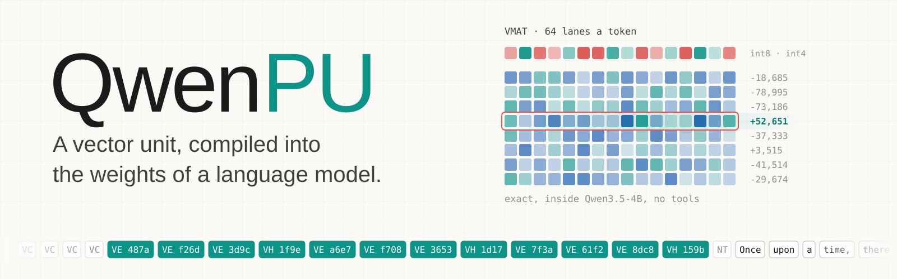
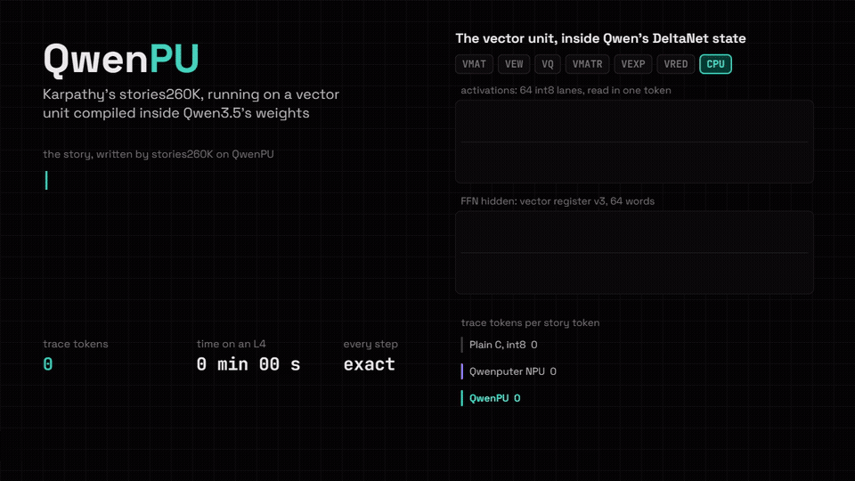

<p align="center">
  
</p>

Model: [Hugging Face](https://huggingface.co/divagr1925/QwenPU)  
Part of [Qwenputer](https://github.com/divagr18/qwenputer), the computer compiled into Qwen3.5's weights.

**QwenPU is Qwen3.5-4B with a 32-bit RISC-V CPU and a vector unit compiled directly into its
weights.** The vector unit adds matrix-vector products, elementwise ops and attention to the CPU,
so a whole neural network runs as a program inside the model's own forward passes. None of the
new weights are learned: a compiler computes every one.

It runs Andrej Karpathy's
[stories260K](https://huggingface.co/karpathy/tinyllamas/tree/main/stories260K), the
260K-parameter Llama from [llama2.c](https://github.com/karpathy/llama2.c), as a C program on the
CPU and its vector unit, and it writes its stories.

> **Work in progress.** QwenPU is exact, but not yet small: the checkpoint is 26.7 GB, so loading
> it whole needs a 40 GB or larger GPU. The story demo and the checks run the computer's layers on
> their own and fit a 24 GB GPU. Trimming the hidden size, and with it the checkpoint, is next.

## A language model inside the language model

[Qwenputer's in-weights NPU](https://github.com/divagr18/qwenputer#in-weights-npu-experimental)
gave the CPU dot-product instructions, one trace token each. QwenPU moves the vector work into a
unit of its own, with its own memories in the model's Gated DeltaNet state, and streams whole
vector results through the token stream: a 64-lane matrix row in a few tokens instead of dozens of
instructions.

| Build of stories260K | Trace tokens per story token |
|---|---|
| Plain C, int8 weights | 2,430,000 |
| Qwenputer NPU: VDOT + SMAQA | 225,000 |
| **QwenPU: the vector unit** | **53,000** |

<p align="center"></p>

Every build writes the same story, token for token:

> Once upon a time, there was a little girl named Lily. She loved to play outside in the park.
> One day, she saw a big, red ball. She wanted to play with it, but it was too high

stories260K's int4 weights are data in the unit's weight memory, loaded from the program, not
compiled into the checkpoint, so any model that fits runs the same way.

## Quickstart

```bash
git clone https://github.com/divagr18/QwenPU && cd QwenPU && uv sync --extra hf
uv run python guests/stories260k/storyrun.py guests/stories260k/stories_vx.elf --vx
```

`storyrun` builds the computer's layers, loads the story program into their DeltaNet state and
runs it free on a GPU executor, checking every step against a reference model of the CPU. To run
the vector unit on the checkpoint's own layers:

```bash
hf download divagr1925/QwenPU --local-dir qwenpu
uv run python -m chipformer.rv.vxcheck qwenpu guests/stories260k/stories_vx.elf --chip-only
```

## The vector unit

The unit sits in the computer's first layers and keeps its memories in DeltaNet heads:

- **Vector registers:** 16 registers of 64 words.
- **Activations:** 384 int8 lanes, read 64 at a time.
- **Weight memory:** 4,152 row-chunks of 64 int4 weights and a row scale, three to a row pair,
  read two rows at a time so the byte reads are exact.
- **K / V caches:** 32 positions; the V cache keeps one value head per position, so a single read
  returns one value dimension across every position.

| Op | Does |
|---|---|
| `VMAT` | int8 · int4 matrix rows, 64 lanes a token, times the row scale; or the argmax |
| `VQ` | quantizes a register into int8 activations or a cache row |
| `VEW` | residual add, SiLU-gated product, RoPE |
| `VMATR` | attention scores over the K cache; probabilities times the V cache |
| `VEXP` | exp-table softmax numerators |
| `VRED` | sum or sum of squares of the activations |
| `VGET`, `VPUT` | move values between the CPU and the unit |

An op starts with a few config tokens carrying its operands, then streams its results, and every
token is one exact step of the compiled layers. SiLU and exp are fixed-point function units,
generic like the CPU's adders. [`docs/vx.md`](docs/vx.md) has the design, and
[`chipformer/rv/vx.py`](chipformer/rv/vx.py) is the reference the circuit matches token for token.

## Checks

- Every op runs random test programs (`tests/test_rv_vx.py`) through the circuit, teacher-forced
  against the reference: exact.
- The story program runs through the circuit's IR on CPU for its first 110,000 steps, and
  free-running on the GPU executor for all 3,184,920, checked against the reference at every
  step: exact.
- The same test programs and the first 30,000 steps of the story program run on the
  checkpoint's own layers (`vxcheck`): exact.

The GPU executor runs the computer at about 3,300 trace tokens a second on an L4, so a story
token takes about 16 seconds, against 41 for the Qwenputer NPU.

| | |
|---|---|
| Base | Qwen3.5-4B, its own weights unchanged |
| Computer | 13 compiled layers before Qwen's 32: RV32IM + Zba + bignum unit + the vector unit |
| Hidden size | 5120 (Qwen's 2560 plus the computer's dims) |
| Size | 26.7 GB in bf16, mostly zero padding |

## Citing

Author: [Divyansh Agrawal](https://orcid.org/0009-0003-0739-2473) (ORCID: [0009-0003-0739-2473](https://orcid.org/0009-0003-0739-2473)).

For the source code, cite the software entry below. GitHub's "Cite this repository" button reads
[CITATION.cff](CITATION.cff).

```bibtex
@software{agrawal2026qwenpu,
  author  = {Agrawal, Divyansh},
  title   = {{QwenPU}: a vector unit compiled into the weights of a language model},
  year    = {2026},
  url     = {https://github.com/divagr18/QwenPU},
  license = {MIT},
  note    = {Author ORCID: https://orcid.org/0009-0003-0739-2473}
}
```

For the Hugging Face model artifact, use DOI [10.57967/hf/11460](https://doi.org/10.57967/hf/11460).
This DOI identifies the model artifact, not a GitHub source-code release.

```bibtex
@misc{agrawal2026qwenpu_model,
  author    = {Agrawal, Divyansh},
  title     = {{QwenPU}},
  year      = {2026},
  publisher = {Hugging Face},
  version   = {0ea39d7},
  doi       = {10.57967/hf/11460},
  url       = {https://huggingface.co/divagr1925/QwenPU},
  license   = {Apache-2.0},
  note      = {Model artifact. Author ORCID: https://orcid.org/0009-0003-0739-2473}
}
```

## Credits

stories260K and llama2.c are by [Andrej Karpathy](https://github.com/karpathy) (MIT). The base
model is [Qwen/Qwen3.5-4B](https://huggingface.co/Qwen/Qwen3.5-4B).

## License

The code is MIT. The model weights are Apache-2.0, as a modified version of
[Qwen/Qwen3.5-4B](https://huggingface.co/Qwen/Qwen3.5-4B): the config is widened and computer
layers are added, but Qwen's own weights are unchanged.
